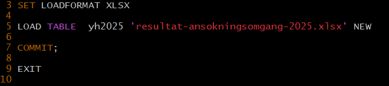
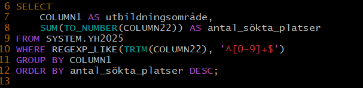
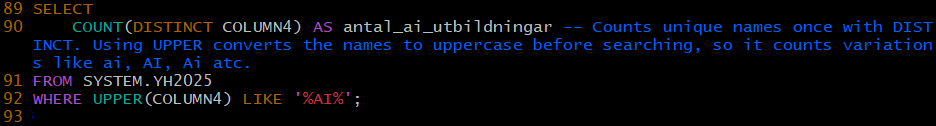
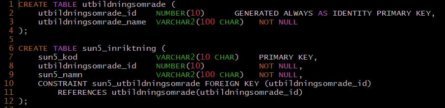
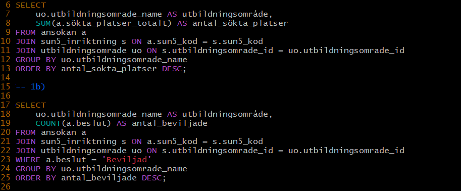

-----
THE SKOOL
-----

0) Load table

Ladda ner tabellen och se till att sedan ta bort allt förutom tabell 3. Jag tog även bort texten som stod i början bara för att göra det enklare att arbeta med. Sedan överförde jag tabellen till min Linux med hjälp av SCP. I skriptet satte jag loadformat till XLSX eftersom det är ett excell dokument.
Jag gav den namnen yh2025 och commitade, sen avslutar jag skriptet med exit.

UPPGIFT 1

a) Jag använder SELECT för att välja vilka columner som ska användas i sökningen. Tabellen namngav inte columnerna automatiskt, så jag skrev dem som "AS" och det korrekta namnet för att det ska synas i sökningen.
Man kan även använda ALTER för att byta rätt på alla namnen, men jag tänkte att det kan ha varit tanken bakom övningen att inte göra det så jag lät det vara som det är. 
Sedan tar jag SUM to number för att summera antalet sökta platser ionom varje utbildningsområde.
FROM anger tabellen, och den laddades in som SYSTEM.YH2025.
Jag använde WHERE REGEXP_LIKE(TRIM) för att filtrera bort rader där column 22 inte består av enbart siffror. ^[0-9]+$ 
GROUP BY samlar utbildningarna inom samma område, tex Data/IT.
ORDER BY ... DESC sorterar så att området med flest sökta platser hamnar först.  
Resultatet visar oss att Ekonomi, Administration och försäljning har flest sökta platser, därefter Data/IT och sedan Teknik och tillverkning. 

b -> g) För dessa frågor använde jag mycket liknande sökningar. 
Jag anväde WHERE för att specificera 'Beviljad' eller 'Avslag' beroende på vad det var ni sökte or ordnade dem i DESCending.
 
h) Här använde jag THEN 1 för att räkna antalen bunden mot distans. Om det är bundet eller distans så retuneras siffran 1. Om det inte stämmer så retuneras NULL. COUNT räknar sedan värdena. 

i) Här använder jag Distinct för att ta unika namn, så att inte två eller fler med samma namn räknas. 
Jag använder UPPER för att förvandla namnen till stora bokstäver före jag söker så den räknar variationer av AI, som tex ai eller Ai. 
'%AI%' är sökningen jag använder.  

UPPGIFT 3

Efter intervjun valde jag ut dessa 5 frågorna då de verkade som de mest relevanta. 

I sökning 1 kan vi se att Teknik och tillverkning har 4 utbildningar med smalt yrkesområde som blivit beviljade. Detta kan indikera att detta är ett bra område att ge sig in på, då det finns en efterfrågan för det.

I fråga 2 kan vi tydligt se att privata huvudmannatyper blir mycket oftare beviljade, så det är att föredra. 

I fråga 3 valde jag att både lista antalen beviljade och avslagna, men att sedan också räkna ut de bästa oddsen. Jag gjorde det genom att räkna beviljade som 1 och avslagna som 0. Om man sedan adderar dem och multiplicerar med 100 får vi fram oddsen. I toppen har vi transporttjänster, journalistik och hälso- och sjukvord. I botten har vi Frisktvård och Data/IT, antagligen eftersom marknaden är ganska saturerad av dessa. 

I fråga 4 använde jag samma princip för att räkna ut oddsen för vilken studie form som blir beviljad. Det saknas 23% eftersom jag inte visade avslagningarna. 

I fråga 5 listade jag antalen beviljade utbildningar efter kommunerna. Jag satte det som ascending för att de som har flest ska hamna längst ner. Man kan lägga till fetch first X rows only om man inte vill få hela listan, men då många har bara 1 utbildning rä detta inte så använbart. 

UPPGIFT 4

Jag delade upp denna i 3 delar. 
1) Först skapade jag de olika tabellerna enligt modellen ni gav mig. Viktigt är att skapa dem i rätt ordning, då de knyts samman via constraints och foreign keys mellan tabellerna.  
Som i bilden här, jag skapar först tabellen utbildningsområdet. Sedan skapar jag sun5_inriktning och refererar till utbildningsområde genom utbildningsområde_id.

2) Sedan skrev jag upp de olika tabellerna och använde LLM för att översätta excell arkets första 20 rader in i tabellerna. 

3) Därefter gjorde jag samma sökningar som i uppgift 1, men anpassat efter denna tabell. Då använder jag join för att sätta ihop flera olika tabeller och få fram resultatet på så sätt. En skillnad på första sökningen är att jag inte behövde använda REGEXP då informationen är korrekt insatt nu. 
Ytterligare en skillnad är att jag inte måste använda Columner och namnge dem genom AS eftersom de alla är korrekta nu. 

